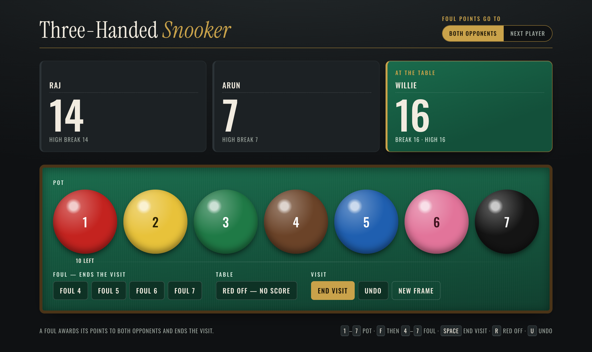

# Snooker Tracker

A scoreboard for snooker with two to five players. One HTML file, no build step, no
dependencies — open `index.html` in a browser and start the frame. On a phone the whole
frame, five players included, fits on one screen, so nobody scrolls between shots.

## Scoring

- **Players** — 2, 3, 4 or 5, switched in the header. Changing it mid-frame can be undone;
  a player taken out of the frame loses their points.
- **Pot** — tap a ball: red 1, yellow 2, green 3, brown 4, blue 5, pink 6, black 7.
  The red shows how many are left and locks at zero.
- **Clearing the colours** — after the last red the striker may take any one colour, and it
  goes back on its spot. From then on the colours come off in order, yellow to black: each
  potted colour leaves the table and only the lowest one left can be tapped. If the visit
  ends before that one colour, the clearance starts at yellow.
- **Foul 4–7** — awards the points and ends the visit.
- **Red off — no score** — takes one red off the table without giving anyone points,
  for a red potted on a foul stroke. It does not end the visit, so that stroke is two
  taps: the foul, then the red off.
- **End visit** — passes to the next player in rotation.
- **Undo** — steps back through every pot, foul, red off and change of visit.
- **New frame** — arms on the first tap, resets on the second. Names, player count and the foul rule stay.

Each player's rail shows their score, the current break while they are at the table,
and their highest break of the frame.

## The foul rule

Snooker with more than two players has no single convention for fouls, so it is a switch in the header:

| Setting | Effect |
| --- | --- |
| **All opponents** (default; "Both" with three players) | every other player receives the penalty |
| **Next player** | only the player who comes to the table next receives it |

With two players both settings mean the same thing, so the switch is hidden.

The line under the table always states the rule in force.

## Keyboard

| Key | Action |
| --- | --- |
| `1`–`7` | pot that value |
| `F` then `4`–`7` | foul of that value |
| `R` | red off, no score |
| `Space` | end visit |
| `U` | undo |

## What it is not

It keeps score; it does not referee. Apart from clearing the colours in order, it will
not enforce red-then-colour order, and it has no free-ball or miss handling.

The frame is saved in the browser it is open in, so a refresh mid-frame loses nothing —
but it stays on that one device. This is one scoreboard at the table, not a phone per
player in sync.

## iPhone app

`ios/` is **Snookerin**, a native SwiftUI app — not the web page in a wrapper. It has the same rules and
the same look, built from native controls:

- a three-second intro when it opens (tap to skip): the cue strikes the white, which rolls
  across and uncovers the name
- then a setup screen: how many are playing (2–5) and who. Blank seats are "Player 1", "Player 2"….
  Saved players (Raj, Ajay, Anvay and Ninad to start) seat with a tap; star a typed name to save
  it, press and hold a saved name to remove it. A frame in progress can be resumed from here,
  and New frame on the table offers "Change players" to come back
- on the table: a visit starts on a red and a colour can only follow a red (tap red again for
  two or more reds on one shot, then the one colour); fouls go to every
  opponent; tap a player to put them at the table; Foul 5/6/7 wear blue, pink and black
- History: who potted which balls and who fouled, visit by visit, for this frame and the
  last 30
- the whole frame fits on one screen, with the table at the bottom where a thumb reaches it
- haptics on pots, fouls and end of visit; New frame asks for confirmation
- the screen stays awake while the app is open, so the phone can sit on the table
- the frame and its undo history survive the app being closed

The rules live in `ios/Snooker/Frame.swift` and are unit-tested in `ios/SnookerTests`.

Needs Xcode 16 or later; runs on iOS 17 and later. The Xcode project is generated from
`ios/project.yml` with [XcodeGen](https://github.com/yonaskolb/XcodeGen) — after adding or
renaming files, run `xcodegen generate` in `ios/`.

1. Open `ios/Snooker.xcodeproj` in Xcode.
2. Select the **Snooker** target → **Signing & Capabilities** and choose your Apple ID as the **Team**.
3. Plug in your iPhone, unlock it, tap **Trust**, and pick it as the run destination.
4. On the iPhone, turn on **Settings → Privacy & Security → Developer Mode** (it asks to restart).
5. Press **Run** (⌘R). The first time, approve the developer under **Settings → General → VPN & Device Management**.

With a free Apple ID the app runs for 7 days before it needs reinstalling from Xcode.
Tests (unit + a UI walk-through of intro → setup → table → history): `xcodebuild test -project ios/Snooker.xcodeproj -scheme Snooker -destination 'platform=iOS Simulator,name=iPhone 17'`.
The icon source is `assets/icon-only.png`.
